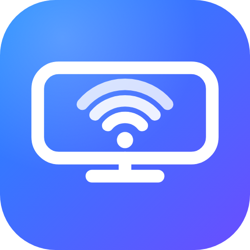

# AirPlay for Android

🌐 [Türkçe](README.tr.md) · [English](README.md) · [Español](README.es.md) · [Français](README.fr.md) · **Deutsch** · [Português](README.pt.md) · [Italiano](README.it.md) · [Русский](README.ru.md) · [日本語](README.ja.md) · [한국어](README.ko.md) · [简体中文](README.zh.md) · [العربية](README.ar.md)

   

Macht aus einem Android-Gerät (Android TV, Smartphone, Tablet, Set-Top-Box) einen **AirPlay-Empfänger** für iPhone und iPad: Bildschirmspiegelung, Video, Fotos, reine Audiowiedergabe (Musik, Spotify, …) und Video-Upload aus Safari ohne Installation.

Beim Start zeigt die App einen QR-Code. Scannen Sie ihn mit der iPhone-Kamera, um die Web-Fernbedienung zu öffnen, oder wählen Sie **TV Alici** (umbenennbar) im Kontrollzentrum > Bildschirmspiegelung bzw. in der AirPlay-Liste.

## Funktionen

- **Bildschirmspiegelung** (H.264-Video, AAC-ELD-Audio) mit Einstellungen für Audio-/Video-Sync und Puffer, Zoom sowie Einpassen/Füllen.
- **Video-AirPlay** (MP4 und HLS) und **Foto-AirPlay**.
- **Reines Audio-AirPlay** (Musik, Spotify, Podcasts) mit einem Vollbild-Bildschirm *Wiedergabe* mit Cover und Titelinfos.
- **Web-Fernbedienung** unter `http://<Geräte-IP>:8080` (PIN-geschützt): Videos aus Safari ohne Installation senden, mehrere Videos in eine Warteschlange stellen, Wiedergabe/Pause/Spulen, Lautstärke, Nachricht auf dem TV anzeigen, Video-Link abspielen, als App zum Home-Bildschirm hinzufügen.
- **Bildschirmmenü auf dem TV** — **MENU** drücken (oder **OK** bei Fernbedienungen ohne MENU-Taste, z. B. Mi TV Stick): Autostart, Schlaftimer, A/V-Sync, Puffer, Zoom, Bildanpassung, Uhr, Statistik, vertrauenswürdige Geräte, Update-Suche.
- **Zugriffskontrolle:** Neue Geräte müssen am TV bestätigt werden (einmal erlauben / immer / ablehnen).
- **In-App-Updates**, geprüft nach Paketname, Version und Signaturzertifikat.
- **12 Sprachen** (je nach Geräte-/Browsersprache): English, Türkçe, Español, Français, Deutsch, Português, Italiano, Русский, 日本語, 한국어, 简体中文, العربية.

## Schnellstart

1. APK mit GitHub Actions bauen (Push auf `main`, dann das Artefakt `tv-alici-apk` herunterladen) oder eine signierte APK von [Releases](https://github.com/ozsinyol/tv-alici/releases) laden.
2. Auf dem Android-Gerät installieren (`adb install app-release.apk` oder die APK auf Smartphone/Tablet öffnen). Beide Geräte müssen im selben WLAN sein.
3. App öffnen und den QR-Code mit der iPhone-Kamera scannen oder „TV Alici“ unter AirPlay / Bildschirmspiegelung wählen.

## Einschränkungen

- Nur klassisches AirPlay (1) und Bildschirmspiegelung — kein AirPlay 2 (Multiroom, gepufferte Audiowiedergabe, Siri/Home).
- FairPlay-geschützte Videos (YouTube, Netflix, Apple TV+ …) werden nicht abgespielt; DRM-Inhalte erscheinen beim Spiegeln schwarz.
- Foto-Diashows werden nicht unterstützt; die Bildschirmspiegelung nutzt ausschließlich H.264.
- AirPlay ist ein proprietäres Apple-Protokoll ohne offizielle Lizenz; dieses Projekt ist für den privaten/experimentellen Gebrauch gedacht.

## Sicherheit und Updates

Die Web-Fernbedienung benötigt die auf dem TV angezeigte PIN (im Request-Header gesendet; fünf Fehlversuche sperren dieses Gerät für 5 Minuten). Release-APKs werden mit einem privaten Schlüssel aus GitHub Secrets signiert, und der integrierte Updater installiert eine APK nur, wenn Paketname, Version und Zertifikat-SHA-256 übereinstimmen.

## Vollständige Dokumentation

Die vollständige Dokumentation (auf Englisch) steht in [README.md](README.md): Build und Signierung, vertrauenswürdige Geräte, Sync-Feinabstimmung, Web-API, manuelles Update, Fehlersuche. Um der App eine Sprache hinzuzufügen, kopieren Sie `app/src/main/res/values/strings.xml` nach `values-<Code>/` und ergänzen Sie einen Block in der `DIL`-Tabelle in `VideoServer.kt`.

## Lizenz

GNU GPL v3 — siehe [LICENSE](LICENSE). Das Projekt verwendet den `playfair`-Code aus [UxPlay](https://github.com/FDH2/UxPlay) (GPL v3) und Apples quelloffenen ALAC-Decoder (Apple Public Source License 2.0, siehe `app/src/main/cpp/alac/APPLE_LICENSE.txt`).
