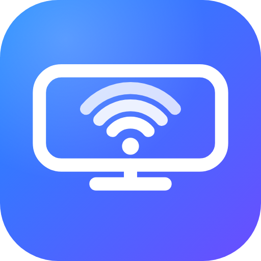

# AirPlay for Android

🌐 [Türkçe](README.tr.md) · [English](README.md) · [Español](README.es.md) · **Français** · [Deutsch](README.de.md) · [Português](README.pt.md) · [Italiano](README.it.md) · [Русский](README.ru.md) · [日本語](README.ja.md) · [한국어](README.ko.md) · [简体中文](README.zh.md) · [العربية](README.ar.md)

   

Transforme un appareil Android (Android TV, téléphone, tablette, box) en **récepteur AirPlay** pour iPhone et iPad : recopie d'écran, vidéo, photos, diffusion audio seule (Musique, Spotify, …) et envoi de vidéos depuis Safari sans rien installer.

Au démarrage, l'application affiche un code QR. Scannez-le avec l'appareil photo de l'iPhone pour ouvrir la télécommande web, ou choisissez **TV Alici** (vous pouvez le renommer) dans le Centre de contrôle > Recopie de l'écran ou dans la liste AirPlay.

## Fonctionnalités

- **Recopie d'écran** (vidéo H.264, audio AAC-ELD) avec réglages de synchronisation audio/vidéo et de tampon, zoom et modes ajuster/remplir.
- **AirPlay vidéo** (MP4 et HLS) et **AirPlay photos**.
- **AirPlay audio seul** (Musique, Spotify, Podcasts) avec un écran *Lecture en cours* plein écran affichant la pochette et les infos du titre.
- **Télécommande web** sur `http://<ip-de-l-appareil>:8080` (protégée par PIN) : envoyez des vidéos depuis Safari sans rien installer, mettez plusieurs vidéos en file d'attente, lecture/pause/avance, volume, affichage d'un message sur la TV, lecture d'un lien vidéo, ajout à l'écran d'accueil comme une app.
- **Menu à l'écran de la TV** — appuyez sur **MENU** (ou **OK** sur les télécommandes sans touche MENU, comme la Mi TV Stick) : démarrage auto, minuterie de veille, synchro A/V, tampon, zoom, ajustement de l'écran, horloge, statistiques, appareils de confiance, recherche de mise à jour.
- **Contrôle d'accès :** les nouveaux appareils doivent être approuvés sur la TV (autoriser une fois / toujours / refuser).
- **Mises à jour dans l'application** vérifiées par nom de paquet, version et certificat de signature.
- **12 langues** (selon la langue de l'appareil/du navigateur) : English, Türkçe, Español, Français, Deutsch, Português, Italiano, Русский, 日本語, 한국어, 简体中文, العربية.

## Démarrage rapide

1. Compilez l'APK avec GitHub Actions (push sur `main`, puis téléchargez l'artefact `tv-alici-apk`) ou téléchargez un APK signé depuis [Releases](https://github.com/ozsinyol/tv-alici/releases).
2. Installez-le sur l'appareil Android (`adb install app-release.apk`, ou ouvrez l'APK sur un téléphone/une tablette). Les deux appareils doivent être sur le même réseau Wi-Fi.
3. Ouvrez l'application et scannez le code QR avec l'appareil photo de l'iPhone, ou choisissez « TV Alici » dans AirPlay / Recopie de l'écran.

## Limites

- Protocoles AirPlay classique (1) et de recopie d'écran uniquement — pas d'AirPlay 2 (multi-pièces, audio avec tampon, Siri/Maison).
- Les vidéos protégées par FairPlay (YouTube, Netflix, Apple TV+ …) ne se lisent pas, et le contenu DRM apparaît noir en recopie.
- Les diaporamas de photos ne sont pas pris en charge ; la recopie d'écran est uniquement en H.264.
- AirPlay est un protocole propriétaire d'Apple, sans licence officielle ; ce projet est destiné à un usage personnel/expérimental.

## Sécurité et mises à jour

La télécommande web demande le PIN affiché sur la TV (envoyé dans un en-tête de requête ; cinq essais erronés bloquent cet appareil pendant 5 minutes). Les APK de version sont signés avec une clé privée conservée dans GitHub Secrets, et le programme de mise à jour intégré n'installe un APK que si le nom du paquet, la version et le SHA-256 du certificat correspondent.

## Documentation complète

La documentation complète (en anglais) se trouve dans [README.md](README.md) : compilation et signature, appareils de confiance, réglage de la synchro, API web, mise à jour manuelle, débogage. Pour ajouter une langue à l'application, copiez `app/src/main/res/values/strings.xml` dans `values-<code>/` et ajoutez un bloc à la table `DIL` de `VideoServer.kt`.

## Licence

GNU GPL v3 — voir [LICENSE](LICENSE). Le projet utilise le code `playfair` d'[UxPlay](https://github.com/FDH2/UxPlay) (GPL v3) et le décodeur ALAC open source d'Apple (Apple Public Source License 2.0, voir `app/src/main/cpp/alac/APPLE_LICENSE.txt`).
