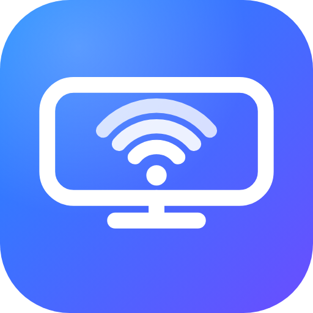

# AirPlay for Android

🌐 [Türkçe](README.tr.md) · **English** · [Español](README.es.md) · [Français](README.fr.md) · [Deutsch](README.de.md) · [Português](README.pt.md) · [Italiano](README.it.md) · [Русский](README.ru.md) · [日本語](README.ja.md) · [한국어](README.ko.md) · [简体中文](README.zh.md) · [العربية](README.ar.md)

   

Turns an Android device (Android TV, phone, tablet, set-top box, smart display) into an **AirPlay receiver** for iPhones and iPads: screen mirroring, video, photos, audio-only streaming (Music, Spotify, …) and video upload from Safari without installing anything.

When it starts, the app shows a QR code. Scan it with the iPhone camera, pick a video on the page that opens, and it plays on the device. The device also appears on the network as an AirPlay receiver named "TV Alici"; choose it in Control Center > Screen Mirroring or in any AirPlay list.

> "TV" in this document also means the Android device the app is installed on; everything works the same way on phones and tablets. For on-screen settings with the remote or touch, see [Android phones and tablets](#android-phones-and-tablets) and [TV menu](#tv-menu).

## Languages

The app UI and the web page (port 8080) follow the device/browser language: **English** (default), **Turkish**, Spanish, French, German, Portuguese, Italian, Russian, Japanese, Korean, Chinese (Simplified) and Arabic (right-to-left); other languages fall back to English. This document is the main (English) documentation; the language links at the top lead to the complete Turkish documentation ([README.tr.md](README.tr.md)) and short summaries in the other languages.

To add a language to the app, create `app/src/main/res/values-<code>/strings.xml` (copy `values/strings.xml`) and add a block for it in the `DIL` table in `VideoServer.kt`. The developer log and the code comments are in English (only the Turkish UI strings and the Turkish documentation are in Turkish).

## Building the APK with GitHub Actions

1. Upload this folder to a GitHub repository (`main` branch).
2. In the repository, the **Actions** tab > **Build APK** workflow runs automatically (or start it with **Run workflow**).
3. When it finishes, download `tv-alici-apk` under **Artifacts** on the run's page.

Pushes to `main` additionally publish a signed APK as a GitHub Release (see [Signing and update security](#signing-and-update-security)).

## Installing on a device

- **Android TV:** enable Developer options and USB/network debugging, then run `adb connect <tv-ip>` and `adb install app-release.apk`. Alternatively, put the APK on a USB drive and install it with a file manager on the TV.
- **Android phone/tablet:** download the APK from the [Releases](https://github.com/ozsinyol/tv-alici/releases) page on the device and open it (grant the "install unknown apps" permission if asked), or use `adb install`. The app icon appears in the launcher.

The iPhone and the Android device must be on the same Wi-Fi network.

## Android phones and tablets

The app works the same way on Android TV and other Android devices: QR screen, AirPlay receiver, connection approval dialog (selected by touch), video, photos and screen mirroring. Remote-control settings (audio/video sync, video buffer, auto-start) are made in the **TV menu** opened with the direction/OK/MENU keys; you can also tap the menu rows (tap = increase/select, long-press = decrease). On a phone or tablet the device's own screen and speaker are used, and the screen stays on during mirroring.

## Signing and update security

The published APK is a release build (not debuggable, optimized native code) and is signed only with a private key stored in GitHub Secrets (`KEYSTORE_B64`, `KEYSTORE_PASSWORD`, `KEY_ALIAS`, `KEY_PASSWORD`); the key is not in the repository. Without the key, the workflow does not publish a release. Before installing, the in-app updater checks the downloaded APK's package name, version number and the SHA-256 fingerprint of the signing certificate (`UPDATE_CERT_SHA256` in `app/build.gradle.kts`); if anything does not match, the APK is deleted. If the key is changed, this fingerprint must be updated too, and the app on the TV must be uninstalled once and installed manually. Local (unsigned) builds do not pass update verification.

## Screen mirroring (AirPlay) and license

The Android device appears on the network as an AirPlay receiver named "TV Alici"; connect to it from the iPhone's Control Center with **Screen Mirroring**. Video (H.264) and audio (AAC-ELD) are supported. For audio only (Music, Spotify, …) see [Audio AirPlay](#audio-airplay-music-etc). The offset between audio and video is adjusted by hand (see below).

To decrypt the FairPlay stream key, this feature uses the `playfair` code from the [UxPlay](https://github.com/FDH2/UxPlay) project (`app/src/main/cpp/playfair`, GNU GPL v3) and the response tables in the same project's `fairplay_playfair.c` (LGPL 2.1+, `AirPlayFairPlay.kt`). For this reason **this repository is licensed under the GNU GPL v3** (see `LICENSE`). The ALAC audio decoder under `app/src/main/cpp/alac` is Apple's open-source code under the Apple Public Source License 2.0 (`app/src/main/cpp/alac/APPLE_LICENSE.txt`).

## Audio AirPlay (Music, etc.)

In apps such as Music, Spotify and Podcasts on the iPhone, choose "TV Alici" from the AirPlay icon and only the audio comes to the TV (ALAC, 44100 Hz, 16-bit, stereo). The audio is decoded with Apple's open-source ALAC decoder under `app/src/main/cpp/alac` and played with a buffer of about 600 ms; since latency does not matter for music, this buffer hides Wi-Fi jitter. Volume, pause and seek (FLUSH) commands from the iPhone are supported. When the iPhone sends song information and cover art, they are shown on the QR screen and on a full-screen **Now playing** screen; lost packets are not re-requested (on a very weak Wi-Fi network you may occasionally hear crackling).

## Audio/video sync

If the audio is out of sync with the picture while mirroring, adjust it in the [TV menu](#tv-menu) or, while mirroring, with the **RIGHT/LEFT** keys (20 ms per press, at most ±500 ms). If the audio arrives **late** relative to the picture, press RIGHT (the picture is delayed); if it arrives **early**, press LEFT (the audio is delayed). The setting is saved; a short notice appears on screen and is written to the log.

**Video buffer (Wi-Fi jitter):** Frames do not arrive over the network at even intervals; if they were drawn the moment they arrive, the picture would stutter. The buffer draws frames at even intervals based on the iPhone's timestamps. The default is **automatic**: the app measures the jitter of the last few seconds and sets the buffer itself between 40 and 160 ms (it grows immediately and shrinks slowly). For manual control, use the **UP/DOWN** keys while mirroring (20 ms steps, 0–200 ms; 0 is off); on the "Video buffer" row of the menu, **OK** returns to automatic. Because the buffer delays the picture, the audio is delayed by the same amount (so sync is preserved), but everything appears that much later. The `Jitter:` line in the log shows the jitter distribution and the number of frames that exceeded the buffer; the `Auto buffer:` line shows changes of the automatic setting.

## Changing the AirPlay name

The name shown in the iPhone's AirPlay list is "TV Alici" by default. To change it, open `http://<device-ip>:8080/name?pin=<PIN>` and type the new name (1–32 characters; the address is also shown on the home screen). The name is saved and the service is re-advertised under the new name; the iPhone's list refreshes within a few seconds. It is useful for telling devices apart (for example "Living room TV", "Pixel 8").

## Connection approval

When an unknown device tries to connect over AirPlay, an **Allow once / Always allow / Deny** dialog appears on the TV (selected with the remote or by touch). If there is no answer within 30 seconds, or it is denied, the connection is closed and the same device is not asked again for 1 minute. "Always allow" makes the device's IP address permanently trusted.

A device that was set to "Always allow" but does not connect for 30 days loses its trust automatically and is asked again on the next connection; for a device in regular use, the period is renewed on every use.

To see and remove trusted devices, open `http://<tv-ip>:8080/trusted?pin=<PIN>` on the iPhone (the address is also shown on the TV's home screen), or use the [TV menu](#tv-menu). A removed device is asked for permission again once its open connection closes.

## Running in the background and audio focus

When the app starts, it starts a foreground service with a small notification, so Android does not kill the process when you leave the app or the screen turns off: music keeps playing and the device stays in the AirPlay list. While audio or mirroring is running, CPU and Wi-Fi locks are held (at most 6 hours, released when the stream ends). When audio starts, audio focus is requested; the sound of another app on the device is lowered or paused. Quitting the app (leaving with Back) stops the service too. On Android 13 and later, if the notification permission has not been granted, the service still runs but the notification may not be visible.

## Zoom while mirroring

While mirroring, the picture is fitted to the screen by default (there may be black bars at the edges). On a touch screen you can pinch with two fingers to zoom up to 4×, and drag with one finger once zoomed in. On devices without a touch screen, the **🔍+ / 🔍− / 1×** buttons on the web page's Remote tab do the same (zooming towards the center). The zoom resets when mirroring ends or restarts. The menu also offers a **Fill (crop)** mode instead of **Fit**.

## Greeting the connected device

When an iPhone or iPad connects for screen mirroring or audio, a short 👋 notice with the device's name appears on the TV ("iPhone" if no name arrives). The QR screen also shows the connected device's name and IP address in a green line.

## Bouncing QR when idle

If the QR screen stays idle for 20 seconds (no key pressed, no touch), the QR code and texts start bouncing around the screen like the old DVD logo, changing color when they hit a wall and showing 🎉 on a perfect corner hit. It also prevents screen burn-in. Pressing any key or touching the screen stops it and returns the QR code to its place; when a connection starts, the screen changes anyway.

## TV menu

While on the QR screen or while mirroring, press the remote's **MENU** key and a menu opens on the screen. **On remotes without a MENU key (for example the Mi TV Stick), the OK (center) key opens the same menu.** The menu closes after 30 seconds without a key press, or with **Back**.

| Row | How to change it |
|---|---|
| Start at boot | LEFT/RIGHT/OK toggles it |
| Sleep timer | LEFT/RIGHT cycles off → 15 → 30 → 60 → 90 → 120 min, OK turns it off; when the time is up, playback and mirroring stop and the QR screen returns (valid for that session only) |
| Audio/video sync | LEFT/RIGHT ±20 ms, OK resets |
| Video buffer | LEFT/RIGHT ±20 ms (0 = off), OK returns to automatic |
| Zoom (only while mirroring) | LEFT/RIGHT ×1.25, OK resets to 1× |
| Screen fit | LEFT/RIGHT/OK: Fit ↔ Fill (crop); saved |
| Clock | LEFT/RIGHT/OK: clock and date on the QR screen on/off |
| Statistics | LEFT/RIGHT/OK: panel in the top right with the resolution, incoming frame rate (frames received from the iPhone, not frames drawn), buffer, input drops (frames dropped after a 1-second feed timeout), Wi-Fi signal and the connected device |
| Trusted devices | RIGHT/OK opens a submenu; OK on a row removes that device's trust (★ = permanent), Back returns |
| Check for updates (shows the installed version) | OK: asks GitHub for the latest version and shows the result on screen |
| Quit app | OK (the foreground service and servers stop too) |
| Close | OK |

Navigate with UP/DOWN. On a touch screen, tapping a row acts as "OK/increase" and a long press as "decrease". While the menu is closed, the old shortcuts during mirroring still work: RIGHT/LEFT for audio/video sync, UP/DOWN for the video buffer.

While music plays (once cover art and song information arrive), a full-screen **Now playing** screen opens: large cover, blurred background, song/artist/album; **Back** returns to the QR screen, and it opens again on the next song. The QR screen also shows an idle clock.

## Start at boot

The "Start when the TV turns on" setting is the first row of the [TV menu](#tv-menu) (off by default). When on, the app starts itself when the TV boots. On Android 10 and later, some TVs prevent launching a screen from the background; in that case the "Display over other apps" permission may be needed under Settings > Apps > AirPlay for Android.

## Photo AirPlay (`/photo`)

Open a photo in Photos and send it to the TV with Share > AirPlay > "TV Alici"; the photo is shown full screen. Back, or stopping from the iPhone, returns to the QR screen. Slideshows (`/slideshows`) are not supported.

## Video AirPlay (`/play`)

Open a video in the Photos app and choose "TV Alici" from the AirPlay icon; the video is sent to the TV and played with ExoPlayer (plain MP4 and HLS). The iPhone's play/pause/skip commands are supported. Only `http(s)` addresses are played; FairPlay-protected streams such as `mlhls://` (for example YouTube) are not supported. The difference from screen mirroring: the TV downloads and decodes the video itself, so the quality is better and the iPhone battery is used less.

AirPlay is Apple's proprietary protocol and is not officially licensed; this project is for personal/experimental use.

## Web interface (port 8080)

The address shown on the device's screen (`http://<device-ip>:8080`) opens a single page that works like a media-server remote. At the bottom are the **Remote · Send · Settings** tabs (Update and Log are under Settings); at the top, the PIN field and a connection indicator showing the TV's name.

- **Remote:** a "Now playing" card (video name, or song/artist for music; a progress bar you can drag to seek; elapsed/total time), a large play/pause button, ±10 s, a volume slider and mute, Next/Stop, zoom buttons while mirroring, and the queue of waiting videos. The state refreshes every second with `GET /api/status`.
- **Send:** choose videos and send them from Safari without installing an app. When several videos are chosen, the first plays immediately and the others are uploaded in order and played automatically; the list of chosen files is shown, and the file name is sent to the TV in the `X-Name` header and appears on the "Now playing" card. **Next** skips to the next video and **Stop** also clears the queue.
- **Play a link (Send tab):** paste the address of a direct (MP4/HLS) video to play it on the TV (`POST /api/play?u=`). On sites where Safari shows no AirPlay icon, copy the code with the **Copy bookmarklet** button and paste it into a bookmark; while on the video page, tap the bookmark and the video's real address is found on the page and sent to the TV. This does not work for `blob:` URLs (MSE, such as YouTube and Netflix) or DRM-protected videos; use screen mirroring for those (DRM content also appears black when mirrored). Note: the video server may reject the TV's request (it has no Referer or cookies).
- **Message to the TV (Send tab):** the short text you type appears on the TV in large letters for 20 seconds (for example "Dinner is ready"); sending an empty text removes it.
- **Settings:** change the AirPlay server name and remove trusted devices; **Update** sends a signed APK from the browser (see below); **Log** shows the app log (**Refresh** updates it).
- **Add to Home Screen:** with Share > Add to Home Screen in Safari, the page opens without the address bar, like an app (the icon and `manifest.json` come from the server). In this full-screen mode the PIN is remembered on the device; in a normal browser tab it is kept only for the session.

The page follows the phone's light/dark setting, and its colors meet WCAG AA contrast (4.5:1).

The old addresses keep working: `/name?pin=<PIN>` and `/trusted?pin=<PIN>` open the same page on the Settings tab, and `/log?pin=<PIN>` returns the log as plain text.

Security: the PIN is sent in the `X-Pin` request header (it is not typed in the address bar). After 5 wrong attempts from the same device, PIN attempts are rejected for 5 minutes. Changes such as renaming and removing a device are made with `POST`; they cannot be triggered by clicking a link.

## Manual update (sending an APK)

On devices without internet or GitHub access, an APK can be sent from the **Update** section of the web interface. The page also shows the installed version (for example `v33`).

1. Choose the APK and press **Send APK** (at most 150 MB).
2. The TV performs the same checks as the automatic update: the package name must be the same, the SHA-256 fingerprint of the signing certificate must match `UPDATE_CERT_SHA256`, and the version must not be older than the installed one. If it is rejected, the reason is shown on the page.
3. If the checks pass, the system's install screen opens on the TV; confirm with the remote. Nothing is installed without this confirmation.

Notes: the app must be open on the TV (on the QR screen). If the app has not been given the "install unknown apps" permission, a permission screen opens on the TV; grant it and send the APK again. Builds signed with another key (for example local/debug builds) are rejected.

## Debugging

- The log is not shown on the TV screen; it can only be read from the web page.
- On the iPhone, `http://<tv-ip>:8080/log?pin=<PIN>` shows the whole log.

## Contributing and security

See [CONTRIBUTING.md](CONTRIBUTING.md) for building, project layout and translation rules, and [SECURITY.md](SECURITY.md) for how to report a vulnerability privately.
