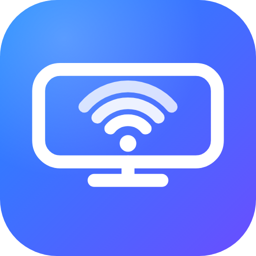

# AirPlay for Android

🌐 [Türkçe](README.tr.md) · [English](README.md) · [Español](README.es.md) · [Français](README.fr.md) · [Deutsch](README.de.md) · [Português](README.pt.md) · [Italiano](README.it.md) · **Русский** · [日本語](README.ja.md) · [한국어](README.ko.md) · [简体中文](README.zh.md) · [العربية](README.ar.md)

   

Превращает Android-устройство (Android TV, телефон, планшет, приставку) в **приёмник AirPlay** для iPhone и iPad: дублирование экрана, видео, фото, передача только звука (Музыка, Spotify, …) и отправка видео из Safari без установки чего-либо.

При запуске приложение показывает QR-код. Отсканируйте его камерой iPhone, чтобы открыть веб-пульт, или выберите **TV Alici** (имя можно изменить) в Пункте управления > Повтор экрана либо в списке AirPlay.

## Возможности

- **Дублирование экрана** (видео H.264, звук AAC-ELD) с настройками синхронизации звука и видео и буфера, масштабированием и режимами «вписать/заполнить».
- **AirPlay для видео** (MP4 и HLS) и **AirPlay для фото**.
- **AirPlay только для звука** (Музыка, Spotify, Подкасты) с полноэкранным экраном *Сейчас играет*: обложка и сведения о треке.
- **Веб-пульт** по адресу `http://<IP-устройства>:8080` (защищён PIN-кодом): отправка видео из Safari без установки, очередь из нескольких видео, воспроизведение/пауза/перемотка, громкость, сообщение на экране ТВ, воспроизведение ссылки на видео, добавление на экран «Домой» как приложения.
- **Экранное меню на ТВ** — нажмите **MENU** (или **OK** на пультах без кнопки MENU, например Mi TV Stick): автозапуск, таймер сна, синхронизация A/V, буфер, масштаб, размер изображения, часы, статистика, доверенные устройства, проверка обновлений.
- **Контроль доступа:** новые устройства нужно подтвердить на ТВ (разрешить один раз / всегда / запретить).
- **Обновления внутри приложения** с проверкой имени пакета, версии и сертификата подписи.
- **12 языков** (по языку устройства/браузера): English, Türkçe, Español, Français, Deutsch, Português, Italiano, Русский, 日本語, 한국어, 简体中文, العربية.

## Быстрый старт

1. Соберите APK через GitHub Actions (push в `main`, затем скачайте артефакт `tv-alici-apk`) или скачайте подписанный APK в разделе [Releases](https://github.com/ozsinyol/tv-alici/releases).
2. Установите его на Android-устройство (`adb install app-release.apk` или откройте APK на телефоне/планшете). Оба устройства должны быть в одной сети Wi-Fi.
3. Откройте приложение и отсканируйте QR-код камерой iPhone либо выберите «TV Alici» в AirPlay / Повтор экрана.

## Ограничения

- Только классический AirPlay (1) и протоколы дублирования экрана — без AirPlay 2 (несколько комнат, буферизованный звук, Siri/Дом).
- Видео с защитой FairPlay (YouTube, Netflix, Apple TV+ …) не воспроизводится, а DRM-контент при дублировании отображается чёрным.
- Слайд-шоу из фото не поддерживаются; дублирование экрана только в H.264.
- AirPlay — закрытый протокол Apple без официальной лицензии; проект предназначен для личного/экспериментального использования.

## Безопасность и обновления

Для веб-пульта нужен PIN-код, показанный на ТВ (передаётся в заголовке запроса; пять неверных попыток блокируют это устройство на 5 минут). APK релизов подписываются закрытым ключом из GitHub Secrets, а встроенное обновление устанавливает APK только при совпадении имени пакета, версии и SHA-256 сертификата.

## Полная документация

Полная документация (на английском) находится в [README.md](README.md): сборка и подпись, доверенные устройства, настройка синхронизации, веб-API, ручное обновление, отладка. Чтобы добавить язык в приложение, скопируйте `app/src/main/res/values/strings.xml` в `values-<код>/` и добавьте блок в таблицу `DIL` в `VideoServer.kt`.

## Лицензия

GNU GPL v3 — см. [LICENSE](LICENSE). Проект использует код `playfair` из [UxPlay](https://github.com/FDH2/UxPlay) (GPL v3) и открытый декодер ALAC от Apple (Apple Public Source License 2.0, см. `app/src/main/cpp/alac/APPLE_LICENSE.txt`).
