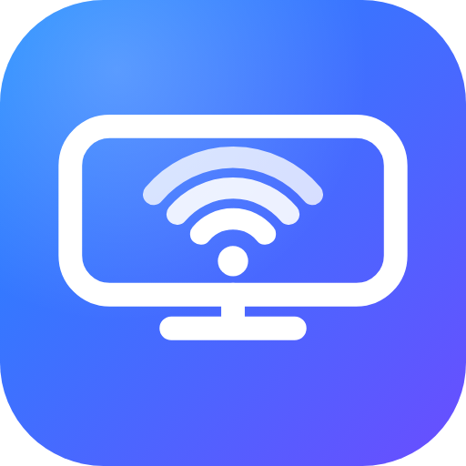

# AirPlay for Android

🌐 **Türkçe** · [English](README.md) · [Español](README.es.md) · [Français](README.fr.md) · [Deutsch](README.de.md) · [Português](README.pt.md) · [Italiano](README.it.md) · [Русский](README.ru.md) · [日本語](README.ja.md) · [한국어](README.ko.md) · [简体中文](README.zh.md) · [العربية](README.ar.md)

   

Android cihazı (Android TV, telefon, tablet, Android kutu/ekran) iPhone'lar için bir **AirPlay sunucusu** yapan uygulama: iPhone'dan ekran yansıtma, video, fotoğraf ve (Safari'den, uygulama kurmadan) video yükleme.

Uygulama açılınca QR kod gösterir. iPhone ile okutulur, açılan sayfadan video seçilir, cihazda oynar. Ayrıca ağda "TV Alici" adıyla bir AirPlay sunucusu olarak görünür; iPhone'un Denetim Merkezi ve AirPlay listesinde bu adla seçilir.

> Bu belgede geçen "TV", uygulamanın kurulu olduğu Android cihaz anlamına da gelir; telefon ve tablette de aynı şekilde çalışır. Kumanda tuşlarıyla yapılan ayarlar için bkz. [Android telefon/tablette kullanım](#android-telefontablette-kullanım).

## Diller

Uygulama arayüzü ve web sayfası (8080) cihaz/tarayıcı diline uyar: **İngilizce** (varsayılan), **Türkçe**, İspanyolca, Fransızca, Almanca, Portekizce, İtalyanca, Rusça, Japonca, Korece, Çince (Basitleştirilmiş) ve Arapça (sağdan sola). Tam İngilizce belge: [README.md](README.md); diğer dillerde kısa özetler için en üstteki dil bağlantılarına bakın. Yeni dil eklemek için `app/src/main/res/values-<kod>/strings.xml` oluşturun ve `VideoServer.kt` içindeki `DIL` tablosuna bir blok ekleyin. Geliştirici günlüğü ve kod yorumları İngilizcedir (yalnızca Türkçe arayüz metinleri ve Türkçe belge Türkçedir).

## APK'yı GitHub Actions ile derleme

1. Bu klasörü bir GitHub deposuna yükleyin (`main` dalı).
2. Depoda **Actions** sekmesi > **Build APK** iş akışı otomatik çalışır (ya da **Run workflow** ile elle başlatın).
3. İş bitince çalıştırmanın sayfasında **Artifacts** altından `tv-alici-apk` dosyasını indirin.

## Cihaza kurma

- **Android TV:** geliştirici seçeneklerini ve USB/ağ hata ayıklamayı açın, ardından:
  `adb connect <tv-ip>` ve `adb install app-release.apk`. Ya da APK'yı USB belleğe koyup TV'deki bir dosya yöneticisiyle kurun.
- **Android telefon/tablet:** APK'yı [Releases](https://github.com/ozsinyol/tv-alici/releases) sayfasından cihazda indirip açın (gerekirse "bilinmeyen kaynaklardan yükleme" iznini verin) ya da `adb install` kullanın. Uygulama simgesi başlatıcıda görünür.

iPhone ve Android cihaz aynı Wi-Fi ağında olmalı.

## Android telefon/tablette kullanım

Uygulama Android TV'de ve diğer Android cihazlarda aynı şekilde çalışır: QR ekranı, AirPlay sunucusu, bağlantı izni penceresi (dokunmayla seçilir), video, fotoğraf ve ekran yansıtma. Aşağıdaki kumanda tuşu ayarları (ses/görüntü kaydırma, görüntü tamponu, otomatik başlatma) yön/OK/MENU tuşlarıyla açılan **TV menüsünden** yapılır; menü satırlarına dokunarak da ayar yapılabilir (dokununca artır/seç, uzun basınca azalt). Telefon/tablette cihazın kendi ekranı ve hoparlörü kullanılır, ekran yansıtma sırasında ekran kapanmaz.

## İmza ve güncelleme güvenliği

Yayınlanan APK bir release derlemesidir (debuggable değil, native kod optimize) ve yalnızca GitHub Secrets'ta duran özel bir anahtarla imzalanır (`KEYSTORE_B64`, `KEYSTORE_PASSWORD`, `KEY_ALIAS`, `KEY_PASSWORD`); anahtar depoda yoktur. Anahtar yoksa workflow release yayınlamaz. Uygulama içi güncelleme, indirilen APK'nın paket adını, sürüm numarasını ve imza sertifikasının SHA-256 parmak izini (`app/build.gradle.kts` içindeki `UPDATE_CERT_SHA256`) kurmadan önce kontrol eder; uyuşmazsa APK silinir. Anahtar değiştirilirse bu parmak izi de güncellenmeli ve TV'deki uygulama bir kez silinip elle kurulmalıdır. Yerel (anahtarsız) derlemeler güncelleme doğrulamasından geçmez.

## Ekran yansıtma (AirPlay) ve lisans

Android cihaz, ağda "TV Alici" adıyla bir AirPlay sunucusu olarak görünür; iPhone'un Denetim Merkezi'nden **Ekran Yansıtma** ile bağlanılır. Görüntü (H.264) ve ses (AAC-ELD) desteklenir. Yalnızca ses (Müzik, Spotify vb.) için bkz. [Ses AirPlay](#ses-airplay-müzik-vb). Ses ile görüntü arasındaki kayma elle ayarlanır (aşağıya bakın).

Bu özellik, FairPlay yayın anahtarını çözmek için [UxPlay](https://github.com/FDH2/UxPlay) projesindeki `playfair` kodunu (`app/src/main/cpp/playfair`, GNU GPL v3) ve aynı projenin `fairplay_playfair.c` dosyasındaki yanıt tablolarını (LGPL 2.1+, `AirPlayFairPlay.kt`) kullanır. Bu nedenle **bu depo GNU GPL v3 ile lisanslıdır** (bkz. `LICENSE`).

## Ses AirPlay (Müzik vb.)

iPhone'da Müzik, Spotify, Podcasts gibi uygulamalarda AirPlay simgesinden "TV Alici"yı seçince yalnızca ses TV'ye gelir (ALAC, 44100 Hz, 16 bit, stereo). Ses, `app/src/main/cpp/alac` altındaki Apple'ın açık kaynak ALAC çözücüsüyle (Apple Public Source License 2.0) çözülür ve yaklaşık 600 ms'lik bir tamponla çalınır; müzikte gecikme önemli olmadığı için Wi-Fi titremesi bu tamponla gizlenir. iPhone'dan ses seviyesi, duraklatma ve sarma (FLUSH) komutları desteklenir. Şarkı bilgisi ve kapak resmi (gelirse) QR ekranında ve tam ekran "Şimdi çalıyor" ekranında gösterilir; kayıp paket yeniden istenmez (çok zayıf Wi-Fi'de ara sıra çıtırtı olabilir).

## Ses/görüntü senkronu

Ekran yansıtırken ses görüntüyle kayık geliyorsa TV kumandasında **SAĞ/SOL** tuşlarına basın (her basış 20 ms, en çok ±500 ms). Ses görüntüden **geç** geliyorsa SAĞ (görüntü geciktirilir), **erken** geliyorsa SOL (ses geciktirilir). Ayar kaydedilir; ekranda kısa bir bilgi çıkar ve günlüğe yazılır.

**Görüntü tamponu (Wi-Fi titremesi):** Kareler ağdan eşit aralıkla gelmez; geldikleri anda çizilirse görüntü takılır. Tampon, kareleri iPhone'un zaman damgasına göre eşit aralıkla çizer. Varsayılan **otomatik**: uygulama son birkaç saniyenin titremesini ölçüp tamponu 40–160 ms arasında kendisi ayarlar (artış hemen, azalış yavaş). Elle ayar için yansıtma sırasında **YUKARI/AŞAĞI** tuşları (20 ms'lik adımlar, 0–200 ms; 0 kapalı); menüde "Görüntü tamponu" satırında **OK** otomatiğe döner. Tampon görüntüyü geciktirdiği için ses de aynı kadar geciktirilir (senkron bozulmaz), ama her şey o kadar daha geç görünür. Günlükteki `Jitter:` satırı titremenin dağılımını ve tamponu aşan kare sayısını, `Auto buffer:` satırı ayar değişimlerini gösterir.

## AirPlay adını değiştirme

iPhone'un AirPlay listesinde görünen ad varsayılan olarak "TV Alici"dır. Değiştirmek için `http://<cihaz-ip>:8080/name?pin=<PIN>` sayfasını açıp yeni adı yazın (1-32 karakter; adres ana ekranda da yazar). Ad kaydedilir ve servis yeni adla yeniden yayınlanır; iPhone listesi birkaç saniye içinde yenilenir. Telefon/tablette cihazları ayırt etmek için ("Salon TV", "Pixel 8" gibi) kullanışlıdır.

## Bağlantı izni

Bilinmeyen bir cihaz AirPlay ile bağlanmak isteyince TV'de **İzin ver / Hep izin ver / Reddet** penceresi çıkar (uzaktan kumandayla ya da dokunarak seçilir). 30 saniye içinde cevap gelmezse ya da reddedilirse bağlantı kesilir ve aynı cihaz 1 dakika boyunca tekrar sorulmaz. "Hep izin ver" cihazın IP adresini kalıcı olarak güvenilir yapar.

"Hep izin ver" denilen bir cihaz 30 gün hiç bağlanmazsa güveni kendiliğinden kalkar ve bir sonraki bağlantıda yeniden sorulur; düzenli kullanılan cihazın süresi her kullanımda yenilenir.

Güvenilen cihazları görmek ve silmek için iPhone'dan `http://<tv-ip>:8080/trusted?pin=<PIN>` sayfasını açın (adres TV'nin ana ekranında da yazar). Silinen cihaz, açık bağlantısı kapanınca yeniden izin sorar.

## Arka planda çalışma ve ses odağı

Uygulama açılınca küçük bir bildirimle ön plan servisi başlatır; böylece uygulamadan çıkınca ya da ekran kapanınca Android süreci öldürmez, müzik kesilmez ve cihaz AirPlay listesinde kalır. Ses ya da yansıtma sürerken CPU ve Wi-Fi kilitleri tutulur (en çok 6 saat, akış bitince bırakılır). Ses başlayınca ses odağı alınır; cihazdaki başka bir uygulamanın sesi kısılır ya da duraklar. Uygulamayı kapatınca (Geri ile çıkış) servis de durur. Android 13 ve üstünde bildirim izni verilmediyse servis yine çalışır ama bildirim görünmeyebilir.

## Yansıtmada yakınlaştırma

Ekran yansıtırken görüntü varsayılan olarak ekrana sığdırılır (kenarlarda siyah boşluk kalabilir). Dokunmatik ekranda iki parmakla sıkıştırarak 4 katına kadar yakınlaştırabilir, yakınlaşınca tek parmakla kaydırabilirsiniz. Dokunmatik olmayan cihazlarda web sayfasının Gönder sekmesindeki **🔍+ / 🔍− / 1×** düğmeleri aynı işi yapar (merkeze doğru yakınlaştırır). Yansıtma bitince ya da yeniden başlayınca yakınlaştırma sıfırlanır.

## Bağlanan cihaza selam

Bir iPhone ya da iPad ekran yansıtma/ses için bağlanınca TV'de kısa bir 👋 bildirimi cihazın adıyla görünür (ad gelmezse "iPhone").

## Boştayken zıplayan QR

QR ekranı 20 saniye boşta (tuşa basılmadan, dokunulmadan) kalırsa QR kodu ve yazılar eski DVD logosu gibi ekranda sekmeye başlar, duvara çarpınca renk değiştirir ve köşeye tam isabet ederse 🎉 çıkar. Aynı zamanda ekran yanmasını önler. Herhangi bir tuşa basınca ya da dokununca durur ve QR yerine döner; bir bağlantı başlayınca ekran zaten değişir.

## TV menüsü

QR ekranındayken ya da ekran yansıtma sırasında kumandanın **MENU** tuşuna basınca ekranda bir menü açılır. **MENU tuşu olmayan kumandalarda (ör. Mi TV Stick) OK (orta) tuşu aynı menüyü açar.** Menü 30 saniye hiçbir tuşa basılmazsa ya da **Geri** ile kapanır.

| Satır | Değiştirme |
|---|---|
| Açılışta otomatik başlat | SOL/SAĞ/OK açıp kapatır |
| Uyku zamanlayıcısı | SOL/SAĞ kapalı → 15 → 30 → 60 → 90 → 120 dk, OK kapatır; süre dolunca oynatma ve yansıtma durur, QR ekranına dönülür (yalnızca o oturumda geçerli) |
| Ses/görüntü kayması | SOL/SAĞ ±20 ms, OK sıfırlar |
| Görüntü tamponu | SOL/SAĞ ±20 ms (0 = kapalı), OK otomatiğe döner |
| Yakınlaştırma (yalnızca yansıtırken) | SOL/SAĞ ×1,25, OK 1× |
| Ekrana sığdırma | SOL/SAĞ/OK: Sığdır ↔ Doldur (kırparak); yansıtırken ve kayıtlı |
| Saat | SOL/SAĞ/OK: QR ekranındaki saat ve tarih açık/kapalı |
| İstatistikler | SOL/SAĞ/OK: sağ üstte çözünürlük, gelen kare hızı (iPhone'dan alınan kareler; ekrana çizilen değil), tampon, girişte atlanan kare (1 sn'lik besleme zaman aşımı), Wi-Fi sinyali ve bağlı cihaz paneli |
| Güvenilen cihazlar | SAĞ/OK alt menüyü açar; satırda OK o cihazın güvenini kaldırır (★ kalıcı), Geri ile dönülür |
| Güncellemeyi kontrol et (kurulu sürüm yazar) | OK: GitHub'daki son sürümü sorar, sonucu ekranda gösterir |
| Uygulamadan çık | OK (ön plan servisi ve sunucular da durur) |
| Kapat | OK |

QR ekranında bağlı iPhone'un adı ve IP'si yeşil bir satırla görünür. Müzik çalarken (kapak ve şarkı bilgisi gelince) tam ekran **"Şimdi çalıyor"** ekranı açılır: büyük kapak, bulanık arka plan, şarkı/sanatçı/albüm; **Geri** tuşu QR ekranına döndürür, sonraki şarkıda yeniden açılır. QR ekranı bekleme saatini de gösterir.

Gezinme YUKARI/AŞAĞI ile yapılır. Dokunmatik ekranda satıra dokunmak "OK/artır", uzun basmak "azalt" işi görür. Menü kapalıyken yansıtma sırasındaki eski kısayollar sürer: SAĞ/SOL ses-görüntü kayması, YUKARI/AŞAĞI görüntü tamponu.

## Açılışta otomatik başlatma

"TV açılınca otomatik başlat" ayarı **TV menüsündeki** ilk satırdır (varsayılan kapalı; bkz. [TV menüsü](#tv-menüsü)). Açıkken TV açılışında uygulama kendini başlatır. Android 10 ve sonrasında bazı TV'ler arka plandan ekran açmayı engeller; bu durumda Ayarlar > Uygulamalar > AirPlay for Android > "Diğer uygulamaların üzerinde göster" izni gerekebilir.

## Fotoğraf AirPlay (`/photo`)

Fotoğraflar'da bir fotoğrafı açıp Paylaş > AirPlay > "TV Alici" ile TV'ye gönderin; fotoğraf tam ekran gösterilir. Geri tuşu ya da iPhone'dan durdurma ile QR ekranına dönülür. Slayt gösterisi (`/slideshows`) desteklenmez.

## Video AirPlay (`/play`)

Fotoğraflar uygulamasında bir videoyu açıp AirPlay simgesinden "TV Alici"yı seçince video TV'ye gönderilir ve ExoPlayer ile oynatılır (düz MP4 ve HLS). iPhone'un oynat/duraklat/ileri-geri sar komutları desteklenir. Yalnızca `http(s)` adresleri oynatılır; `mlhls://` gibi FairPlay korumalı akışlar (ör. YouTube) desteklenmez. Ekran yansıtmadan farkı: görüntüyü TV kendisi indirip çözer, bu yüzden kalite daha iyi, iPhone pili daha az harcanır.

AirPlay protokolü Apple'a aittir ve resmî olarak lisanslanmamıştır; bu proje kişisel/deneysel kullanım içindir.

## Web arayüzü (port 8080)

Cihazın ekranındaki adres (`http://<cihaz-ip>:8080`) her şeyin bir arada olduğu tek bir sayfa açar; üstte PIN alanı, altında sırayla şu bölümler vardır:

- **TV'ye mesaj:** Yazılan kısa metin TV ekranında 20 saniye büyük yazıyla görünür ("Yemek hazır" gibi); boş gönderince kalkar.
- **Gönder:** Video seçip gönderme ve oynatma kumandası (Safari'den, uygulama kurmadan). Birden fazla video seçilirse ilki hemen oynar, diğerleri sırayla yüklenip bitince otomatik oynatılır; **Sonraki** düğmesi bir sonraki videoya atlar, **Durdur** sırayı da temizler.
- **Ayarlar:** AirPlay sunucu adını değiştirme ve güvenilen cihazları silme.
- **Uygulamayı güncelle:** Release anahtarıyla imzalı APK'yı tarayıcıdan gönderme (aşağıya bakın).
- **Günlük:** Uygulama günlüğü (açılır bölüm; **Yenile** ile güncellenir).

Eski adresler çalışmaya devam eder: `/name?pin=<PIN>` ve `/trusted?pin=<PIN>` aynı sayfayı Ayarlar bölümünde açar, `/log?pin=<PIN>` düz metin günlüğü verir.

Güvenlik: PIN istekte `X-Pin` başlığıyla gider (adres çubuğuna yazılmaz). Aynı cihazdan 5 yanlış denemeden sonra 5 dakika boyunca PIN denemesi reddedilir. İsim değiştirme ve cihaz silme gibi değişiklikler `POST` ile yapılır; bir bağlantıya tıklamakla tetiklenemez.

## Web kumandası (yeni arayüz)

Web sayfası (`http://<cihaz-ip>:8080`) bir medya sunucusu kumandası gibi çalışır: altta **Kumanda · Gönder · Ayarlar** sekmeleri (Güncelle ve Günlük, Ayarlar'ın altında).

- **Kumanda:** "Şu an oynuyor" kartı (video adı ya da müzikte şarkı/sanatçı, ilerleme çubuğu, geçen/toplam süre), büyük oynat/duraklat, ±10 sn, ses kaydırıcısı ve sessize alma, Sonraki/Durdur, yansıtma sırasında yakınlaştırma düğmeleri ve bekleyen videoların sırası. Durum saniyede bir `GET /api/status` ile yenilenir; ilerleme çubuğunu sürükleyerek ileri/geri sarılır.
- **Gönder:** Seçilen dosyaların listesi görünür; birden fazla video sırayla yüklenir. Dosya adı TV'ye `X-Name` başlığıyla iletilir ve "Şu an oynuyor" kartında görünür.
- **Bağlantıdan oynat (Gönder sekmesi):** Düz adresli (MP4/HLS) bir videonun adresini yapıştırıp TV'de oynatabilirsiniz (`POST /api/play?u=`). Safari'de AirPlay simgesi çıkmayan sitelerde **Yer imi kodunu kopyala** düğmesiyle alınan kodu bir yer imine yapıştırın; video sayfasındayken yer imine dokununca sayfadaki videonun gerçek adresi bulunup TV'ye gönderilir. `blob:` adresli (YouTube, Netflix gibi MSE) ve DRM'li videolarda adres bulunamaz; onlar için ekran yansıtma kullanılır (DRM'li içerik yansıtmada da siyah görünür). Uyarı: video sunucusu TV'nin isteğini (Referer/çerez olmadan) reddedebilir.
- **Ana ekrana ekle:** Safari'de Paylaş > Ana Ekrana Ekle ile sayfa adres çubuğu olmadan, uygulama gibi açılır (simge ve `manifest.json` sunucudan gelir). Bu tam ekran modunda PIN cihazda hatırlanır; normal tarayıcı sekmesinde yalnızca oturum boyunca tutulur.
- Açık ve koyu tema telefonun ayarına göre değişir; renkler WCAG AA kontrastını (4,5:1) sağlar.

## Elle güncelleme (APK gönderme)

İnternet ya da GitHub erişimi olmayan cihazlarda, web arayüzündeki **Uygulamayı güncelle** bölümünden APK gönderilebilir. Sayfa kurulu sürümü de gösterir (ör. `v33`).

1. APK'yı seçip **APK gönder**'e basın (en fazla 150 MB).
2. TV, otomatik güncellemeyle aynı kontrolü yapar: paket adı aynı olmalı, imza sertifikasının SHA-256 parmak izi `UPDATE_CERT_SHA256` ile eşleşmeli ve sürüm kurulu sürümden eski olmamalı. Reddedilirse nedeni sayfada yazar.
3. Kontrol geçerse TV'de sistemin kurulum ekranı açılır; kumandayla onaylayın. Bu onay olmadan kurulum yapılmaz.

Notlar: Uygulama TV'de açık (QR ekranında) olmalıdır. Uygulamaya "bilinmeyen kaynaklardan yükleme" izni verilmemişse TV'de izin ekranı açılır; izni verip APK'yı tekrar gönderin. Başka anahtarla imzalı (ör. yerel/debug) derlemeler reddedilir.

## Hata ayıklama

- Günlük TV ekranında gösterilmez, yalnızca web sayfasından okunur.
- iPhone'dan `http://<tv-ip>:8080/log?pin=<PIN>` adresi tüm günlüğü gösterir.

## Katkı ve güvenlik

Derleme, proje yapısı ve çeviri kuralları için [CONTRIBUTING.md](CONTRIBUTING.md) (İngilizce), güvenlik açığını özel olarak bildirmek için [SECURITY.md](SECURITY.md) (İngilizce) dosyasına bakın.
